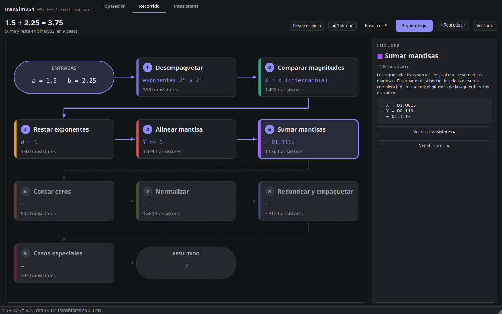
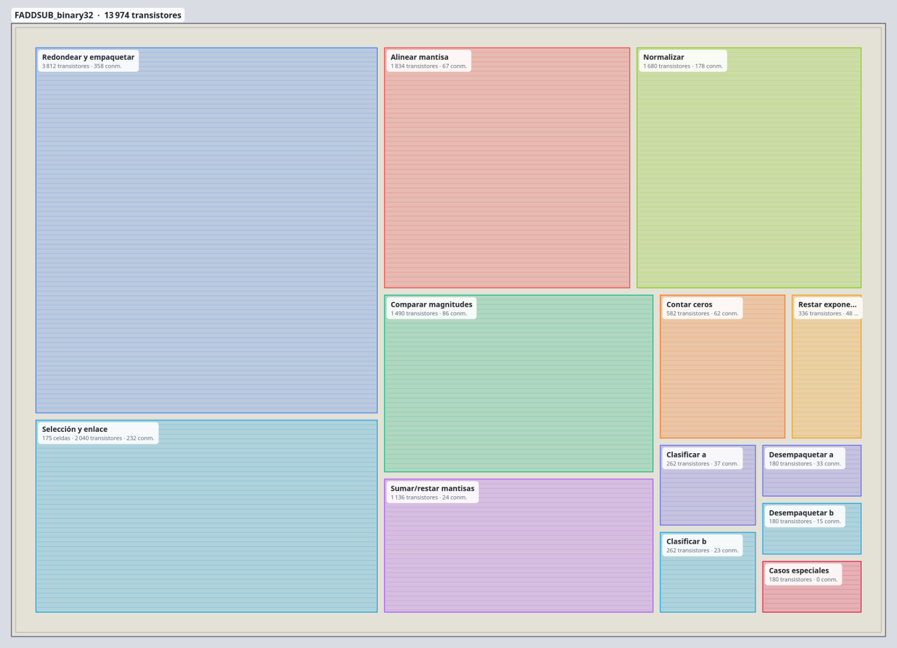
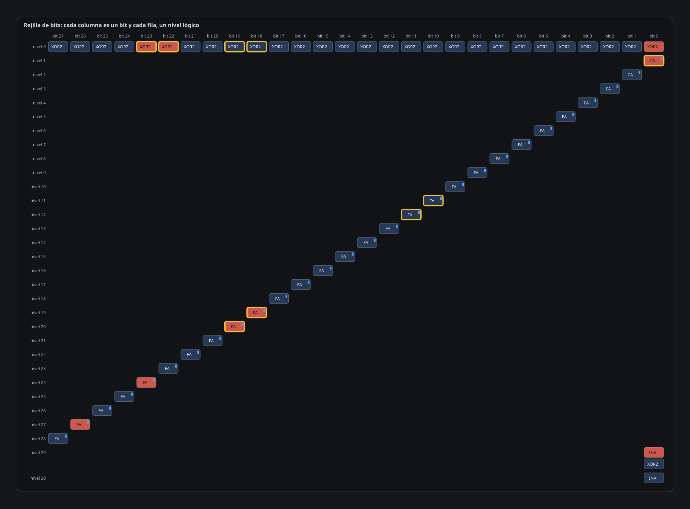
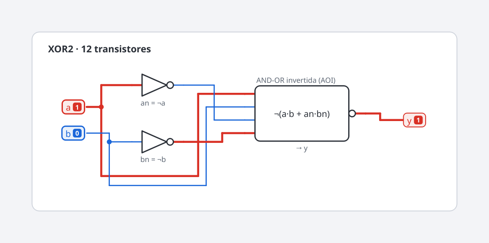
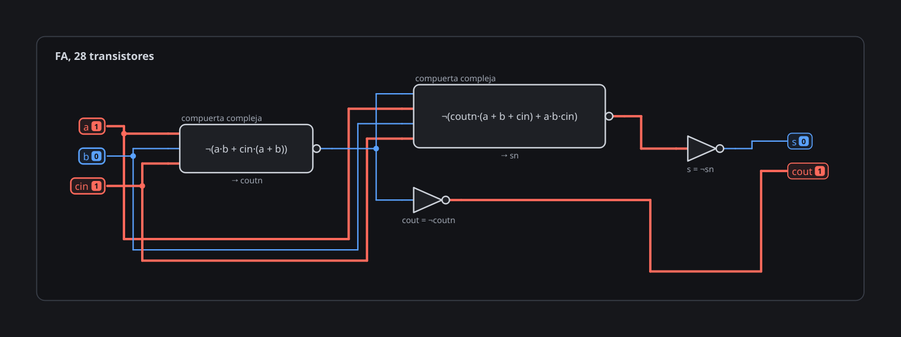
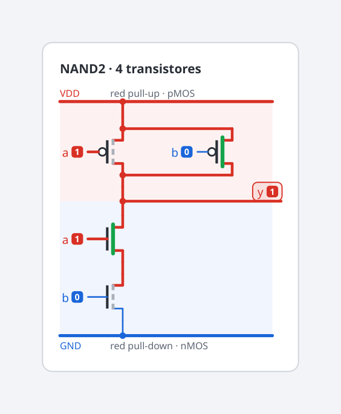
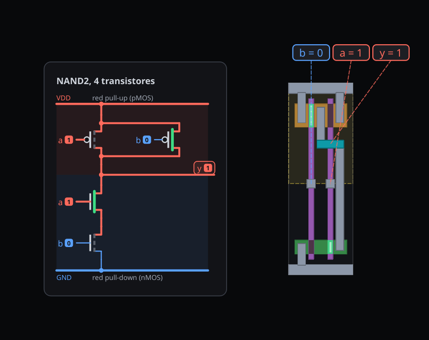

## El problema

- El enunciado pide emular **al menos 100 transistores** y, con ellos, sumar, restar,
  multiplicar y dividir números con signo en **IEEE 754**.
- En los cursos, la aritmética de punto flotante se ve como fórmula; rara vez se ve
  cómo resulta de transistores que se abren y se cierran.
- TranSim754 calcula cada operación haciendo conducir o no a transistores nMOS y pMOS
  concretos, y lo compara bit a bit con el estándar.

## Arquitectura por capas

| Capa | Contenido |
|---|---|
| L0 | Simulador switch-level: nodos {0, 1, X, Z} con fuerzas (Bryant, 1984) |
| L1 | Celdas CMOS: INV, NAND2, NOR2, XOR2, MUX2, sumador completo, latch, flip-flop |
| L2 | Bloques: sumadores RCA y CLA, restador, comparador, desplazador, LZC |
| L3 | ALU entera de 32 bits y FPU: FADD, FSUB, FMUL, FDIV |
| L4 | Máquina T754: decodificador, banco de registros, control |
| L5 | CLI `transim`, interfaz gráfica y métricas |

## Cómo se usa

| Pestaña | Para qué |
|---|---|
| **Operación** | Escribir a y b, elegir + − × ÷ y el formato, **Calcular en transistores**. Resultado, bits y flags; un clic en un bit lo invierte. |
| **Recorrido** | La misma operación en las etapas del hardware; **Siguiente** avanza y el panel explica cada cuenta. |
| **Transistores** | Del plano del chip a cada transistor: rejilla de bits, compuertas, esquema CMOS y silicio. |

Se abre con `transim gui`, en modo exposición: oscuro, sin menús ni atajos de teclado.
`transim gui --completo` muestra además los menús, la pestaña Programa (la CPU T754) y
el historial (ADR-0019).

## Del transistor a la celda

- **Inversor:** 1 pMOS + 1 nMOS (2 T).
- **NAND2:** pMOS en paralelo y nMOS en serie (4 T).
- **Sumador completo espejo:** 28 T, colocados directamente.
- **Flip-flop maestro-esclavo:** dos latches de transmission gates (22 T).
- Reglas de la biblioteca: las entradas solo llegan a compuertas y las salidas son
  restauradas. Así cada celda es componible y el motor acelerado puede tabularla.

## Dos motores de simulación

- **switch:** evaluación exacta por componentes conectados por canal; resuelve carga
  retenida, reparto de carga y cortocircuitos.
- **cached:** tabula las celdas combinacionales primitivas y simula el resto con el
  motor exacto.
- Mismo estado y mismos conteos en 300 secuencias de un circuito mixto y en 1 500
  circuitos aleatorios.

## FADD/FSUB en transistores

1. Desempaquetar y clasificar los operandos.
2. Ordenar por magnitud con el comparador.
3. Restar exponentes y alinear el menor (con sticky).
4. Sumar o restar mantisas de p + 4 bits.
5. Normalizar con el LZC y el desplazador.
6. Redondear al par (G, R, S) y empaquetar; elegir entre resultado numérico y
   especial (NaN, ±∞).

## Recorrido paso a paso



- Cada etapa del hardware con la cuenta hecha con los bits de la simulación:
  d = 128 − 127 = 1, 1.10₂ >> 1 = 0.11₂, 01.001₂ + 00.110₂ = 01.111₂.
- También la multiplicación (arreglo de AND y sumadores) y la división (divisor no
  restaurador, un bit del cociente por fila).

## Demostración

```
$ transim calc 1.5 + 2.25 --trace
  a      =  1.5   0x3FC00000
  b      =  2.25  0x40100000
  a + b  =  3.75  0x40700000
  cálculo: transistores (13974 T)
```

- `transim calc 1 / 3` → `0x3EAAAAAB`, inexacto.
- `transim run`: programas en la máquina T754; `transim gui`: la interfaz gráfica.

## Del chip al transistor



- Plano ilustrativo (ADR-0017): el área sale del número de transistores, no de un
  layout con reglas de diseño. Doble clic en un bloque para entrar.

## Dentro de un bloque: el acarreo



- La operación se reproduce con **un retardo por celda** y se comprueba nodo por nodo
  contra el resultado del motor (ADR-0018).
- 1.5 + 2.25 partiendo de 0 + 0: el sumador de mantisas termina en el retardo 24 y la
  unidad en el 54; el peor caso (camino crítico) es 176.

## De la celda a las compuertas



- Cada etapa CMOS se dibuja como la compuerta que implementa, deducida de su red
  pull-down: serie = AND, paralelo = OR, salida negada (ADR-0016).
- Se comprueba contra la simulación en todas las combinaciones de entrada.

## El sumador completo por dentro



- Es un **sumador espejo** de 28 transistores, no un XOR más un AND: la vista muestra el
  circuito que se simula.

## Esquema CMOS de una celda



- La red pull-up lleva la salida a 1 y la pull-down a 0; nunca conducen las dos a la
  vez.

## La celda y su silicio



- El layout se genera del netlist y se verifica contra él: sin cortocircuitos ni nodos
  abiertos (ADR-0015). Al pasar el ratón por un transistor se resalta en los dos
  dibujos.

## Ciclos de reloj estimados

- El simulador es de retardo cero; los ciclos se **derivan del camino crítico**
  (ADR-0014): cada celda cuesta una unidad y el periodo es el de la ALU entera
  (39 celdas).
- FADD/FSUB y FMUL de binary32: **5 ciclos**; FDIV: **22 ciclos**.
- Cada ciclo muestra qué etapas del datapath ocupa y cuánto conmutó cada etapa.
- Un divisor más rápido reduciría los ciclos de FDIV: el número sale del circuito, no
  se fija a mano.

## Verificación

- Cada bloque se compara con un **modelo de referencia**, y este con NumPy.
- Cuatro operaciones × dos formatos: todos los pares borde y 10 000 aleatorios.
- **0 discrepancias** bit a bit, incluidos los cinco flags.
- 628 pruebas automáticas; las 611 rápidas corren en cada cambio.

## Transistores por unidad

| Unidad (binary32) | Transistores | Profundidad (celdas) |
|---|---:|---:|
| ALU entera de 32 bits | 1 484 | 39 |
| FADD/FSUB | 13 974 | 176 |
| FMUL | 29 966 | 157 |
| FDIV | 40 048 | 852 |
| Banco de 8 registros de 32 bits | 14 230 | — |
| **Máquina T754 completa** | **≈ 100 600** | — |

## Área, velocidad y actividad

| Sumador de 32 bits | Transistores | Profundidad | Actividad α |
|---|---:|---:|---:|
| Ripple-carry | 896 | 32 | 0,39 |
| Carry-lookahead | 3 526 | 19 | 0,31 |

## Transistores en las CPU

- 1947: transistor de contacto puntual; 1959: MOSFET; 1963: lógica CMOS.
- CMOS: redes nMOS y pMOS complementarias, consumo estático casi nulo.
- Evolución: planar → FinFET (22 nm, 2011) → GAA/nanosheet (3 nm, 2022).
- Ley de Moore frente al escalamiento de Dennard, que terminó hacia 2005.
- TranSim754 modela la conmutación y simplifica tensiones, retardos y fugas.

## Conclusiones

- Las cuatro operaciones IEEE 754 se calculan en transistores simulados y coinciden
  bit a bit con el estándar.
- Cada decisión tiene un costo medible: el CLA gana profundidad desde 16 bits a
  cambio de casi 4 veces más transistores; α aproxima P ≈ α · C · V² · f.
- Siguiente paso: control de la máquina en compuertas y flip-flops, y optimización del
  divisor.

## Referencias

- Bryant, R. E. (1984). A switch-level model and simulator for MOS digital systems.
  *IEEE Transactions on Computers, C-33*(2), 160–177.
- IEEE. (2019). *IEEE standard for floating-point arithmetic* (IEEE Std 754-2019).
- Koren, I. (2002). *Computer arithmetic algorithms* (2.ª ed.). A K Peters.
- Weste, N. H. E., & Harris, D. M. (2011). *CMOS VLSI design* (4.ª ed.).
  Addison-Wesley.
